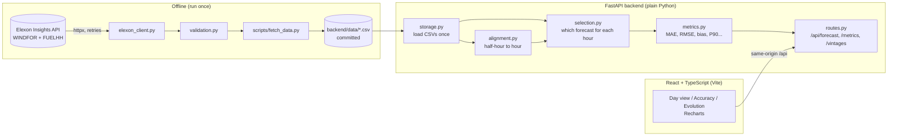

# GB Wind Forecast Monitor

A small web app for energy traders buying power on the GB day-ahead market. For any delivery
day in the study period it shows **the national wind forecast that was available at the
decision time**, and it measures **how accurate those forecasts were**, so purchase decisions
can be made with a known error range.

Scope: GB national wind only, Elexon data only, purchase decisions made in January 2026
(delivery days **2 Jan – 1 Feb 2026**).

**Live app:** _add the Vercel URL here after deploying (see [Deploying to Vercel](#deploying-to-vercel))._

---

## Contents

- [What you can do in the app](#what-you-can-do-in-the-app)
- [Running it locally](#running-it-locally)
- [Tests, linting and CI](#tests-linting-and-ci)
- [Refreshing the data](#refreshing-the-data)
- [Deploying to Vercel](#deploying-to-vercel)
- [Architecture](#architecture)
- [Methodology](#methodology)
- [What the January 2026 data shows](#what-the-january-2026-data-shows)
- [API reference](#api-reference)
- [Project structure](#project-structure)
- [Assumptions and limitations](#assumptions-and-limitations)
- [AI tools used](#ai-tools-used)

## What you can do in the app

| View | What it answers |
|---|---|
| **Day view** | "What did the forecast say when I had to decide, and what actually happened?" Pick a delivery day and a decision time. You see the forecast used vs the actual, a shaded likely range, gaps for missing hours, headline numbers, the hours covered and a safety margin for buying. |
| **Forecast accuracy** | "How far can I trust the forecast?" Pick a date range. Then either judge the forecast available at a decision time, or judge forecasts made at least N hours ahead (1–48). You see headline numbers, error percentiles, an error histogram, error by hour of day and error by how far ahead the forecast was made. |
| **Forecast evolution** | "How did the forecast change as the day got closer?" Every forecast published for one delivery day, with the one used at decision time highlighted and the ones published too late shown dashed. |

All times are shown in UK time (GMT, the same as UTC in January). Power is in megawatts (MW).

## Running it locally

The committed CSV files hold all the data, so no API keys and no internet connection to
Elexon are needed to run the app.

### Option 1: Docker (recommended)

Requires Docker Desktop (or Docker Engine with Compose v2).

```bash
docker compose up --build
```

- App: <http://localhost:8080>
- API: <http://localhost:8000/api/health> (interactive docs at <http://localhost:8000/docs>)

If port 8000 or 8080 is already used on your machine, copy `.env.example` to `.env` and change
`BACKEND_PORT` / `FRONTEND_PORT`, or set them for one run:

```bash
BACKEND_PORT=8010 docker compose up --build        # macOS / Linux / Git Bash
```
```powershell
$env:BACKEND_PORT="8010"; docker compose up --build  # Windows PowerShell
```

Stop with `Ctrl+C`, or `docker compose down` if you started it with `-d`.

### Option 2: Without Docker

Requires Python 3.11+ and Node.js 20+. Use two terminals.

**Terminal 1: backend** (from the repository root)

```bash
cd backend
python -m venv .venv
# Windows PowerShell:   .venv\Scripts\Activate.ps1
#   (if PowerShell refuses to run it: Set-ExecutionPolicy -Scope Process Bypass, then try again)
# macOS / Linux / Git Bash:   source .venv/bin/activate   (Git Bash on Windows: source .venv/Scripts/activate)
pip install -r requirements-dev.txt
uvicorn app.main:app --port 8000
```

Check it: <http://localhost:8000/api/health> should return `{"status":"ok", ...}`.

**Terminal 2: frontend** (from the repository root)

```bash
cd frontend
npm ci
npm run dev
```

Open <http://localhost:5173>. The Vite dev server forwards `/api` requests to the backend on
port 8000, so start the backend first.

**Port 8000 already in use?** Start the backend on another port, e.g.
`uvicorn app.main:app --port 8010`. Then point the frontend at it:
- macOS / Linux / Git Bash: `API_PORT=8010 npm run dev`
- Windows PowerShell: `$env:API_PORT="8010"; npm run dev`

## Tests, linting and CI

```bash
# backend (inside backend/, with the virtualenv active)
pytest                      # 46 tests: selection, alignment, metrics, validation, client, API
ruff check . ../api         # lint
ruff format --check . ../api

# frontend (inside frontend/)
npm run lint                # eslint
npm run format:check        # prettier
npm run build               # TypeScript type-check + production build
```

GitHub Actions ([.github/workflows/ci.yml](.github/workflows/ci.yml)) runs all of the above on every
push and pull request, and also checks that both Docker images build.

## Refreshing the data

The app never calls Elexon while running. The data was downloaded once and committed:

```bash
cd backend
python -m app.scripts.fetch_data
```

This downloads the forecasts and actuals, validates them, and rewrites
`backend/data/windfor.csv`, `backend/data/fuelhh.csv` and `backend/data/manifest.json`.

| Dataset | Endpoint | Range fetched | Rows |
|---|---|---|---|
| Forecasts (WINDFOR) | `/datasets/WINDFOR/stream` | published 30 Dec 2025 00:00 – 1 Feb 2026 23:59 UTC | 19,856 (272 forecasts × 73 hours) |
| Actuals (FUELHH, `fuelType=WIND`) | `/datasets/FUELHH/stream` | settlement days 1 Jan – 2 Feb 2026 | 1,584 (33 days × 48 half-hours) |

How the fetch works:
- **Retries:** 429, 5xx and network errors are retried up to 5 times with exponential
  backoff (1, 2, 4, 8, 16 s), or after the `Retry-After` delay if the server sends one.
- **Cut-off responses:** neither endpoint pages its results. If a response looks cut off,
  meaning its newest timestamp is earlier than expected, the script re-fetches in 7-day
  chunks.
- **Validation** checks that:
  - every forecast has 73 hourly points,
  - every day has 48 actual values,
  - there are no duplicate keys,
  - every actual is fuel type `WIND`,
  - every forecast point is on the hour.

  Every failed check is logged as `WARNING VALIDATION FAILED: ...` and recorded under
  `validation_warnings` in `manifest.json`. The current data passed every check.
- **Why the 1 Feb forecasts are included:** in horizon mode with a small N, the hours of
  1 Feb need forecasts published that same day. Without them the app would quietly use an
  older forecast. The 264 forecasts published up to the end of 31 Jan are all included.

## Deploying to Vercel

The repository is set up for Vercel as-is:
- **Frontend:** built as a static site (`frontend/dist`).
- **Backend:** FastAPI runs as one Python serverless function ([api/index.py](api/index.py)),
  which reads the bundled CSV files.
- **Routing:** [vercel.json](vercel.json) sends every `/api/*` request to that function.

The browser therefore only ever calls its own origin, so no CORS setup is needed.

**Bundle size:** about 18 MB unzipped (FastAPI + pydantic + tzdata + about 1 MB of CSV),
well under Vercel's 250 MB limit. That's why the runtime uses plain Python: no pandas or numpy.

Steps (the first deploy creates the project):

1. Log in once: `npx vercel login` (`npx` runs the Vercel CLI without a global install).
2. From the repository root: `npx vercel link` and accept the defaults. When asked for the
   project settings, keep what `vercel.json` provides.
3. Deploy: `npx vercel deploy --prod`.
4. Check it in a private/incognito window:
   - `https://<your-app>.vercel.app/` shows the app,
   - `https://<your-app>.vercel.app/api/health` returns `{"status":"ok",...}`.
5. If the page asks for a Vercel login, turn off *Vercel Authentication* under
   Project → Settings → Deployment Protection. Production URLs are normally public, but
   preview URLs are protected by default.
6. Paste the production URL into the "Live app" line at the top of this README.

Alternative: push the repository to GitHub and use **Add New → Project → Import** in the Vercel
dashboard. Keep the root directory as the repository root; `vercel.json` sets the build.

## Architecture



The layers only depend on the layer before them:
Elexon client → data storage → forecast selection → metrics → API routes. The selection and
metric functions are pure functions of in-memory data, so they are unit-tested without the API.

## Methodology

### Decision time (no look-ahead)

For delivery day **D**, the purchase decision is made at a cutoff on **D-1**. The default is
**09:00 UK time**, just before the GB day-ahead auctions close (about 09:20 EPEX, 09:50 Nord Pool).
The cutoff can be changed in the app.

For every hour of D, the app uses **only the newest forecast whose publish time is at or before
the cutoff**:
- A forecast published exactly at the cutoff counts.
- A forecast published after the cutoff is never used.

The test suite checks this on every day of the study period: 0 hours use a later forecast.

Example: for 11 Jan 2026 with a 09:00 cutoff, the forecast used was published at
10 Jan 07:30. With a 09:30 cutoff, the forecast published exactly at 10 Jan 09:30 is used.

### Horizon mode

For each target hour T, use the **newest forecast published at least N hours before T**
(N = 1–48). The cutoff rule and horizon mode share one function: they only differ in the
deadline, either *cutoff on D-1* or *T − N hours*. This shows how accuracy changes with how far
ahead a forecast was made.

### Missing hours

If the chosen forecast has no value for a target hour, that hour is **MISSING**. The app does
**not** fall back to an older or newer forecast, and does **not** interpolate. Hours without an
actual are also missing. Missing hours:
- are left out of every metric,
- show as gaps in the charts,
- are reported as coverage, e.g. "Hours with data: 22/24".

Real examples:
- With a 01:00 cutoff, the newest forecast for 11 Jan was published on 9 Jan at 22:30 and ends
  at 11 Jan 21:00. So 22:00 and 23:00 are missing, and coverage is 22/24.
- In horizon mode with N = 48, the forecast published 48 hours earlier often doesn't reach the
  target hour, so coverage drops to 589/744 hours.

Each WINDFOR forecast covers a fixed 73-hour window that starts at 21:00 UTC the evening
before its publish date. So a forecast also contains a few hours *before* it was published.
Those hours can never be selected, because the deadline is always before the target hour. The
evolution view also leaves them out.

### Aligning forecasts and actuals

Forecasts are hourly; actuals (FUELHH) are half-hourly. Everything is compared hourly. The
**actual for hour H is the mean of the two half-hours starting at H:00 and H:30**: the average
power over the hour, which is what an hourly forecast value represents. If either half-hour is
missing, the whole hour is missing. This lives in one function, `hourly_actuals()` in
[backend/app/alignment.py](backend/app/alignment.py).

Worked example, 11 Jan 2026 00:00 UTC:
- **Half-hours:** 00:00 = 8,203 MW and 00:30 = 8,225 MW.
- **Hourly actual:** (8,203 + 8,225) / 2 = **8,214 MW**.
- **Forecast** (published 10 Jan 07:30): 12,050 MW, so error = 12,050 − 8,214 = **+3,836 MW**.

### Error metrics

**error = forecast − actual** (MW). A **positive** error means the forecast was too high (an
over-forecast). That's the risky case: less wind arrives than expected, so the utility has
under-bought. The same sign is used everywhere: API, tables, charts and the decision helper.

| Metric | Definition | In the app |
|---|---|---|
| MAE | mean of \|error\| | "Average miss" |
| RMSE | √(mean of error²); weights big misses more | "Typical miss (RMSE)" |
| Bias | mean of error | "Average bias" (+ = too high) |
| Max absolute error | max of \|error\| | "Biggest miss" |
| Normalised MAE | MAE ÷ mean actual over the same hours | "Miss vs average wind" |
| Percentiles | P5, P10, P50, P90, P95 of error | "How big the errors get" |
| By hour of day | MAE and bias per UK hour (00–23) | chart |
| By lead time | MAE and bias per whole hour of (target − publish time) | chart |

Plain MAPE is not used, because some hours have very little wind and dividing by a near-zero
actual blows up. Percentiles use linear interpolation between ranks, the same as Excel
`PERCENTILE.INC` and numpy's default.

### Decision helper (safety margin)

**X = P90 of the error** over the selected period. The app shows:

> Historically, in 90% of hours, actual wind was at least **forecast − X MW**.

This is true by construction: in 90% of hours error ≤ X, i.e. actual ≥ forecast − X. Because
P90 is interpolated between two neighbouring hours, the exact share can be a hair under 90%:
669 of 744 hours (89.9%) at the default cutoff. The Day view uses the whole
2 Jan – 1 Feb period at the chosen cutoff. The Accuracy view uses the selected range and mode.

The Day view's shaded **likely range** is [forecast − P90, forecast − P10] from the same
history. That's where the actual landed in 80% of past hours.

**Caveats** (also shown in the app's tooltip):
- It is an **empirical estimate from past data, not a guarantee**.
- It is measured on the **same January 2026 data** the app shows (**in-sample**), so it may look
  better than it would on new data.
- Accuracy can be **different in other weather conditions or seasons**.

## What the January 2026 data shows

At the default 09:00 cutoff, over 744 hours (2 Jan – 1 Feb, 744/744 covered):

| | |
|---|---|
| Average miss (MAE) | 2,039 MW (18% of average wind of 11,284 MW) |
| Typical miss (RMSE) | 2,505 MW |
| Average bias | **+1,748 MW**: forecasts were too high on average |
| Biggest miss | 6,870 MW |
| P10 / P50 / P90 error | −549 / +1,592 / +4,098 MW |
| Safety margin (P90) | actual ≥ forecast − 4,098 MW in 90% of hours |

The forecasts were usually too high this month. Part of this is likely curtailment: FUELHH is
metered output after wind farms were turned down for grid constraints, while the forecast is
for wind generation. See [limitations](#assumptions-and-limitations).

## API reference

All endpoints are `GET`, read only the bundled data, and return JSON. Times are UTC
(ISO 8601, `Z`); power is MW. Interactive docs: `/docs` on the backend.

| Endpoint | Parameters | Returns |
|---|---|---|
| `/api/health` | – | status and loaded row counts |
| `/api/forecast` | `date` (required, 2026-01-02 … 2026-02-01), `cutoff` (HH:MM UK, default 09:00) | 24 hourly rows: target time, forecast, publish time, lead time, actual, error, missing flag, likely range; plus the forecast used, decision time, coverage, day summary, decision helper |
| `/api/metrics` | `start`, `end` (default: whole window), and either `cutoff` (default 09:00) or `horizon_hours` (1–48) | coverage, summary metrics + percentiles, decision helper, histogram, error by hour of day, error by lead time |
| `/api/vintages` | `date` (required), `cutoff` (default 09:00) | every forecast for that day, with which one was used for the decision and which were published after it, plus hourly actuals |

Invalid input returns a clear message in `detail`, e.g.:
- `400` — `date must be a delivery day from 2026-01-02 to 2026-02-01 (purchase decisions made in January 2026), got 2025-12-01`
- `400` — `cutoff must be a UK time in HH:MM format, e.g. 09:00, got '25:99'`
- `400` — `Use either cutoff or horizon_hours, not both`
- `422` — `horizon_hours: Input should be less than or equal to 48`

## Project structure

```
.
├── README.md                     This file
├── docker-compose.yml            Runs backend (port 8000) + frontend (port 8080) together
├── .env.example                  Optional settings (CORS origins, data folder, host ports). No secrets needed
├── .gitignore                    Keeps virtualenvs, node_modules, builds and .env out of git
├── .github/workflows/ci.yml      CI: backend lint+tests, frontend lint+format+build, Docker build
├── vercel.json                   Vercel: build the frontend, route /api/* to the Python function
├── .vercelignore                 Files Vercel should not upload (virtualenvs, node_modules, tests)
├── .python-version               Python version for Vercel's Python runtime (3.12)
├── requirements.txt              Read by Vercel; points to backend/requirements.txt
├── api/
│   └── index.py                  Vercel serverless entrypoint: makes backend/ importable, exposes the FastAPI app
├── backend/
│   ├── Dockerfile                Backend image: python:3.12-slim + uvicorn, with a health check
│   ├── .dockerignore             Keeps .venv and tests out of the image
│   ├── pyproject.toml            ruff and pytest settings
│   ├── requirements.txt          Runtime dependencies (FastAPI, pydantic, tzdata, uvicorn)
│   ├── requirements-dev.txt      + httpx (data fetch and test client), pytest, ruff
│   ├── data/
│   │   ├── windfor.csv           Forecasts: publish_time, start_time, generation_mw (UTC)
│   │   ├── fuelhh.csv            Actuals: start_time, fuel_type, generation_mw (UTC, half-hourly)
│   │   └── manifest.json         Where/when the data was fetched, row counts, validation warnings
│   ├── app/
│   │   ├── main.py               Creates the FastAPI app, optional CORS, readable validation errors
│   │   ├── config.py             Study window, default cutoff, UK time zone, data paths, CORS origins
│   │   ├── elexon_client.py      Offline only: Elexon requests with retry/backoff and chunked fallback
│   │   ├── validation.py         Data checks (73 points per forecast, 48 values per day, duplicates, WIND only)
│   │   ├── storage.py            Reads the CSVs once into typed, cached records
│   │   ├── alignment.py          hourly_actuals(): half-hourly actuals -> hourly means
│   │   ├── selection.py          The forecast-selection rule (decision-time and horizon modes), HourRow
│   │   ├── metrics.py            MAE, RMSE, bias, max, nMAE, percentiles, P90 helper, groupings, histogram
│   │   ├── schemas.py            Pydantic response models (the API contract)
│   │   ├── routes.py             /api endpoints, input validation, response building
│   │   └── scripts/
│   │       └── fetch_data.py     python -m app.scripts.fetch_data: download, validate, save
│   └── tests/
│       ├── test_selection.py     No look-ahead, cutoff == publish time, missing hours, horizon mode, lead time
│       ├── test_alignment.py     Hour = mean of two half-hours; missing half-hour -> missing hour
│       ├── test_metrics.py       Every metric, percentile interpolation, P90 decision helper, groupings
│       ├── test_validation.py    Each data check reports a clear warning
│       ├── test_elexon_client.py Retry on 429, give up after max retries, cut-off detection
│       └── test_api.py           Endpoints on the real data, incl. 11 Jan checks and leakage count = 0
└── frontend/
    ├── Dockerfile                Multi-stage: Node build -> nginx serving the static site
    ├── nginx.conf                Serves the site and forwards /api to the backend container
    ├── .dockerignore             Keeps node_modules and dist out of the build context
    ├── package.json              Scripts (dev, build, lint, format) and dependencies
    ├── package-lock.json         Exact dependency versions
    ├── vite.config.ts            React + Tailwind plugins; dev proxy /api -> localhost:8000 (or API_PORT)
    ├── tsconfig.json             Strict TypeScript settings
    ├── eslint.config.js          ESLint (TypeScript + React hooks rules, Prettier-compatible)
    ├── .prettierrc               Prettier settings (100-char lines)
    ├── .prettierignore           Files Prettier skips
    ├── index.html                HTML shell
    └── src/
        ├── main.tsx              Mounts the React app
        ├── App.tsx               Header, tabs, footer; shares the chosen day/cutoff between views
        ├── api.ts                fetchJson() with readable errors + useApi() hook (loading/error/data)
        ├── types.ts              TypeScript types matching the API responses
        ├── format.ts             UK-time and MW formatting, study-window constants
        ├── chartColors.ts        Chart colours (colour-blind-safe forecast/actual pair)
        ├── index.css             Tailwind import and page background
        ├── components/
        │   ├── ui.tsx            KPI card, chart card, info tooltip, legend item, loading/error/empty states
        │   ├── Controls.tsx      Delivery-day and decision-time inputs
        │   └── DecisionHelperCard.tsx  The P90 safety-margin sentence, example and caveat tooltip
        └── views/
            ├── DayView.tsx       Forecast vs actual chart with likely range and gaps, KPIs, hourly table
            ├── AccuracyView.tsx  Period metrics in decision-time or horizon mode, histogram, groupings
            └── EvolutionView.tsx Every forecast for a day, decision-time forecast highlighted
```

## Assumptions and limitations

- **Hourly averages.** Each hourly WINDFOR value is treated as the average power over that
  hour, and compared with the mean of the two FUELHH half-hours.
- **What is measured.** FUELHH `WIND` is metered, transmission-connected wind generation.
  Embedded (distribution-connected) wind is not included. The output is *after* any
  curtailment, so hours when wind farms were turned down count as forecast error. This
  probably explains part of the positive bias.
- **Time zone.** UK time is handled with `Europe/London`. In January UK time = GMT = UTC, so
  each delivery day has 24 hours; daylight-saving days were not needed or tested.
- **In-sample numbers.** The safety margin and likely range come from the same January data
  the app shows, so they describe this month and may be optimistic for new data, other
  weather or other seasons.
- **One month of data.** All numbers come from one winter month; other seasons may differ.
- **Lead time vs hour of day.** With one fixed decision time, lead time and hour of day move
  together. The app says so, and offers horizon mode to compare lead times on their own.
- **Static data.** The app reads a snapshot fetched once (see `manifest.json`). Elexon can
  restate data later; re-run the fetch script to refresh it.
- **No authentication.** The app is read-only public data; there are no accounts or secrets.

## AI tools used

_To be completed._
