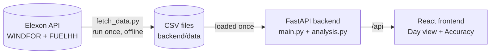

# GB Wind Forecast Monitor

A web app for a UK energy utility that buys power on the GB day-ahead market. It shows the
national wind forecast that was available at the decision time, compares it with the wind
that was actually generated, and measures how accurate the forecasts were.

Scope: GB national wind, Elexon data only, purchase decisions made in January 2026
(delivery days 2 Jan – 1 Feb 2026).

**Live app:** https://gb-wind-forecast.vercel.app

## 🚀 Tech Stack

- **React + TypeScript**: frontend
- **Tailwind CSS + Recharts**: styling and charts
- **Vite**: build tool
- **Python + FastAPI**: backend API (plain Python, no pandas)
- **Docker + nginx**: local deployment
- **Vercel**: hosting (static frontend + Python serverless function)
- **Elexon BMRS API**: data source (WINDFOR forecasts, FUELHH actuals)

## ✨ Features

- **Day view**: pick a decision day and time. See the forecast you had for the next day vs actual wind, with a likely range
- **Forecast accuracy**: average miss, bias, percentiles, accuracy per day and an error histogram
- **Safety margin**: "in 90% of past hours, actual wind was at least forecast − X MW"

## 🏗️ Architecture



The running app never calls Elexon. The data is downloaded once and committed. The frontend
always calls `/api` on its own address: through the Vite proxy locally, nginx in Docker, and a
rewrite on Vercel. So no CORS setup is needed.

## 📐 How it works

- **Decision time:** a decision is made on day D-1 at a cutoff (default **09:00 UK time**,
  changeable) for delivery day D. Decision days are 1–31 Jan 2026.
- **Forecast selection:** for each hour of D, the app uses the newest forecast published
  **at or before** the cutoff that covers that hour. A forecast published exactly at the
  cutoff counts. A later forecast is never used (no look-ahead).
- **Missing hours:** if no such forecast exists, or there is no actual, the hour is missing.
  It shows as a gap, is left out of the numbers and is never interpolated. Coverage is shown
  as "Hours with data", e.g. 22/24.
- **Hourly alignment:** forecasts are hourly and actuals are half-hourly. The actual for hour
  H is the average of the H:00 and H:30 half-hours; both are needed.
- **Error = forecast − actual.** Positive means the forecast was too high. That is the risky
  case, because the utility buys too little.

| Metric | Meaning |
|---|---|
| Average miss (MAE) | Average of \|error\| |
| Typical miss (RMSE) | √ average of error², so big misses count more |
| Average bias | Average error. + means the forecasts were too high |
| Biggest miss | Largest \|error\| in a single hour |
| Miss vs average wind | MAE ÷ average actual. Plain MAPE is not used, because hours with almost no wind make it explode |
| P10 / P50 / P90 | Error percentiles (linear interpolation, like Excel) |

**Safety margin:** X = P90 of the error, so in 90% of past hours, actual ≥ forecast − X.
- It is an estimate from past data, **not a guarantee**.
- It is measured on the **same January data** the app shows (in-sample).
- Accuracy may differ in other weather or seasons.

## 📊 What January 2026 shows

These figures use the default 09:00 decision time, across 744 of 744 hours:

| | |
|---|---|
| Average miss | 2,039 MW (18% of average wind, 11,284 MW) |
| Average bias | **+1,748 MW**: forecasts were usually too high |
| Safety margin | Actual ≥ forecast − 4,098 MW in 90% of hours |

## 📁 Project Structure

```
root/
├── README.md               # This file
├── docker-compose.yml      # Runs backend (port 8000) + frontend (port 8080)
├── .env.example            # Optional settings: host ports, data folder (no secrets needed)
├── .gitignore              # Keeps virtualenvs, node_modules, builds and .env files out of git
├── vercel.json             # Vercel: build the frontend, send /api/* to the Python function
├── .vercelignore           # Files Vercel should not upload
├── .python-version         # Python version for Vercel (3.12)
├── requirements.txt        # Python dependencies for Vercel (points to backend/)
└── api/index.py            # Vercel entrypoint: exposes the FastAPI app

backend/
├── app/
│   ├── __init__.py         # Marks app as a Python package
│   ├── analysis.py         # Forecast selection, half-hour -> hour actuals, error metrics
│   ├── main.py             # FastAPI app: loads the CSVs once, /api endpoints, input checks
│   └── fetch_data.py       # Downloads and checks the Elexon data (offline only)
├── data/
│   ├── windfor.csv         # Forecasts: publish_time, start_time, generation_mw (UTC)
│   ├── fuelhh.csv          # Actuals: start_time, fuel_type, generation_mw (UTC, half-hourly)
│   └── manifest.json       # Data source, fetch time, row counts, validation warnings
├── tests/
│   ├── test_analysis.py    # Selection rule, no look-ahead, half-hour average, metrics, P90
│   └── test_api.py         # Endpoints on the real data, incl. 0 forecasts after the cutoff
├── Dockerfile              # Python 3.12 image running uvicorn, with a health check
├── .dockerignore           # Keeps .venv and tests out of the image
├── pyproject.toml          # pytest settings
├── requirements.txt        # Runtime: FastAPI, pydantic, tzdata, uvicorn
└── requirements-dev.txt    # Adds httpx (data fetch, test client) and pytest

frontend/
├── src/
│   ├── App.tsx             # Header, tabs and layout
│   ├── DayView.tsx         # Forecast vs actual for one decision
│   ├── AccuracyView.tsx    # Accuracy over a period
│   ├── shared.tsx          # API hook, types, formatting, small UI components
│   ├── index.css           # Tailwind import and page background
│   └── main.tsx            # React entry point
├── index.html              # HTML shell
├── Dockerfile              # Multi-stage: Node build -> nginx
├── nginx.conf              # Serves the site and forwards /api to the backend container
├── .dockerignore           # Keeps node_modules and dist out of the build
├── package.json            # Scripts and dependencies
├── package-lock.json       # Exact dependency versions
├── tsconfig.json           # Strict TypeScript settings
└── vite.config.ts          # React + Tailwind; dev proxy /api -> localhost:8000
```

## ⚙️ Prerequisites

- Docker Desktop, **or**
- Python 3.11+ and Node.js 20+

No API keys are needed. The data is already saved in `backend/data/`.

## 🐳 Run with Docker

```bash
docker compose up --build
```

- App: http://localhost:8080
- API: http://localhost:8000/api/health (docs at http://localhost:8000/docs)

If a port is already in use, copy `.env.example` to `.env` and change `FRONTEND_PORT` / `BACKEND_PORT`.

## 🛠️ Run without Docker

```bash
# Terminal 1: backend
cd backend
python -m venv .venv
.venv\Scripts\activate          # Windows (macOS/Linux: source .venv/bin/activate)
pip install -r requirements-dev.txt
uvicorn app.main:app --port 8000

# Terminal 2: frontend
cd frontend
npm ci
npm run dev
```

Open http://localhost:5173. The frontend forwards `/api` requests to the backend.
If port 8000 is busy, run the backend on another port (e.g. `--port 8010`) and start the
frontend with `API_PORT=8010` set.

## 🧪 Tests

```bash
cd backend && pytest             # 17 backend tests
cd frontend && npm run build     # frontend type-check + build
```

## 🔄 Refresh the Data

```bash
cd backend
python -m app.fetch_data
```

This downloads the forecasts and actuals from Elexon and checks them. It then rewrites
`backend/data/`:
- **Downloading:** fetches in 7-day chunks, retrying with backoff if Elexon is busy (HTTP 429)
  or has server errors.
- **Checks:** every forecast must have 73 hourly points and every day 48 half-hours. Any
  failure is printed as a warning and saved in `manifest.json`.
- **Current data:** 272 forecasts (19,856 rows) and 1,584 actual values, with no warnings.

## 🔌 API

| Endpoint | Description |
|---|---|
| `GET /api/health` | Status check and loaded row counts |
| `GET /api/forecast?date=2026-01-10&cutoff=09:00` | For a decision day: the next day's forecast vs actual, hour by hour |
| `GET /api/accuracy?start=2026-01-01&end=2026-01-31&cutoff=09:00` | Accuracy over a range of decision days |

Invalid input returns a clear message, e.g.
`400 {"detail": "date must be a decision day from 2026-01-01 to 2026-01-31, got 2026-03-01"}`.

## ⚠️ Assumptions & Limitations

- Each hourly forecast value is treated as the average power over that hour.
- UK time uses `Europe/London`. In January UK time equals UTC, so every day has 24 hours.
- Actual wind (FUELHH) is metered output after curtailment, which likely explains part of the
  forecasts being too high. Embedded (small, distribution-connected) wind is not included.
- Results come from one month (January 2026) and may differ in other seasons.
- The safety margin is measured on the same data the app shows, so it is an estimate, not a guarantee.
- The app uses a saved snapshot of the data. Run the fetch script again to refresh it.

## 🤖 AI Tools Used

**Claude Code** (Anthropic's AI coding assistant) was used to help write code, tests,
configuration and this README, and to review the code. The design decisions and final code
were reviewed by the author.
